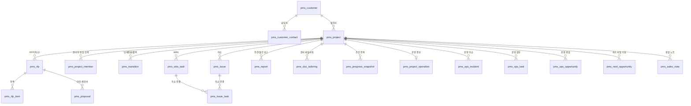
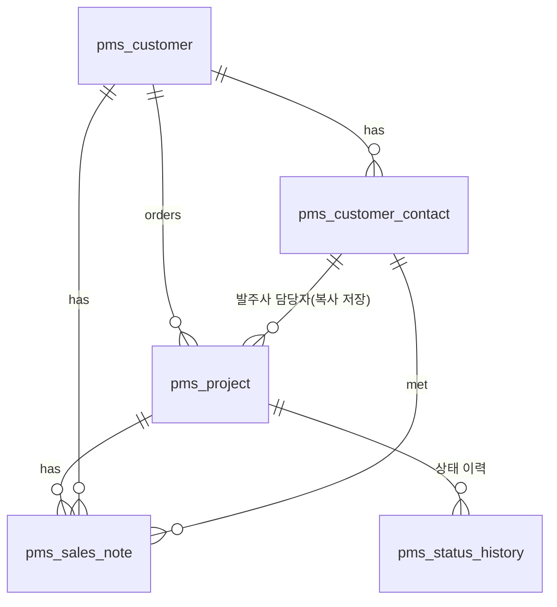
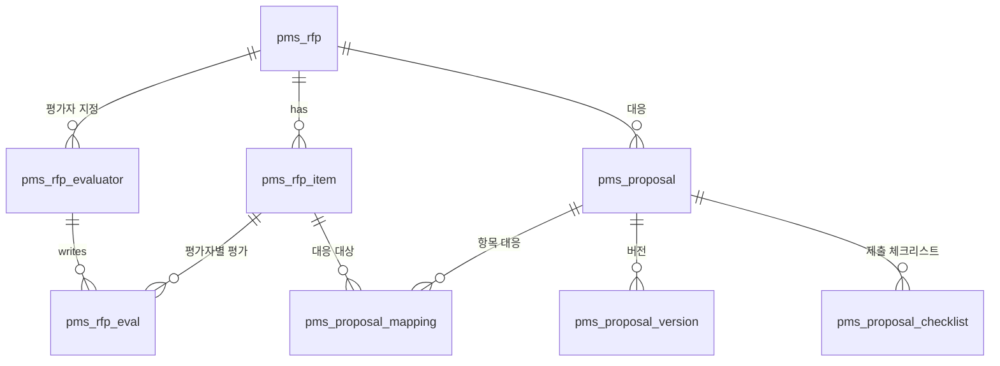
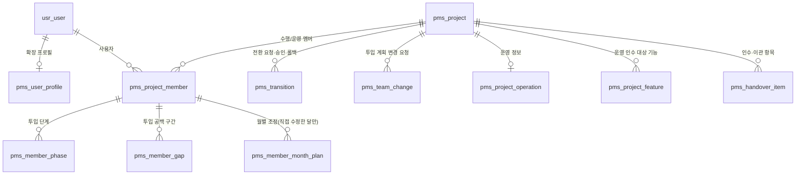
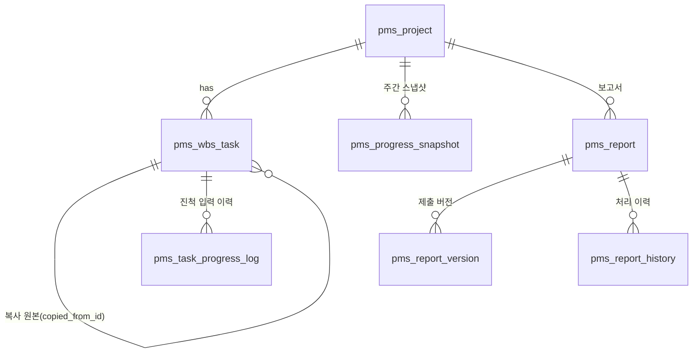
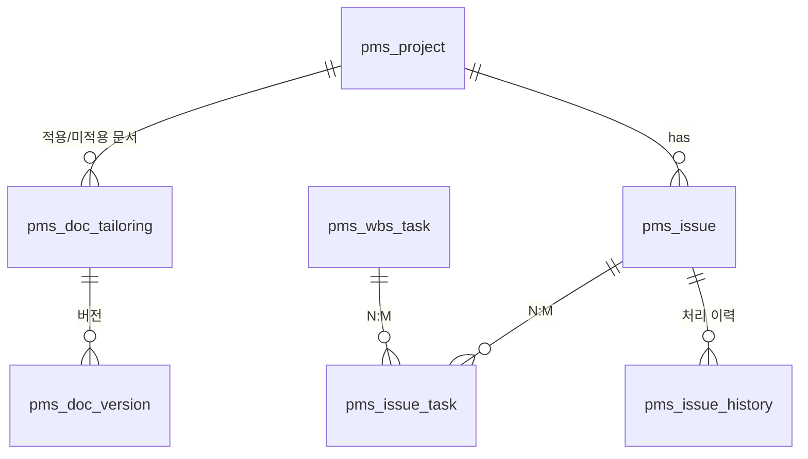
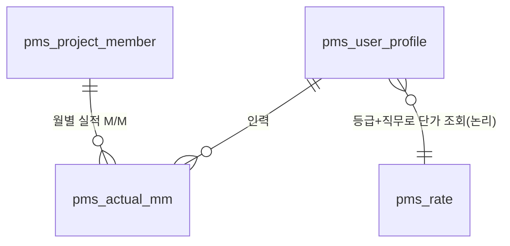
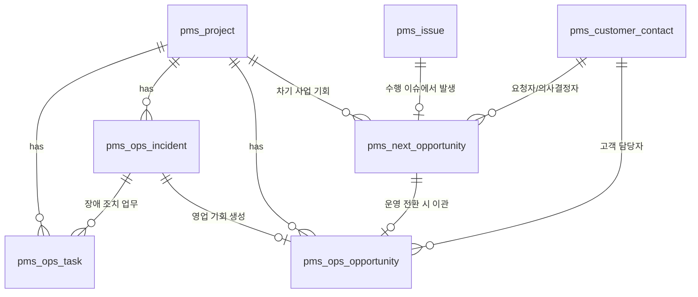

# PMS ERD 설계 (module-pms)

> 상태: **초안 v0.1 (2026-10-22)** — `01-요구사항-초안.md` v2.8 / 프론트 목업(`frontend/src/pages/apps/PMS/*Store.js`)을 근거로 도출.
> 목업이 확정한 구조만 담았고, 확정되지 않은 항목은 8절 「남은 결정」에 모았다.

## 1. 설계 원칙 (기존 프레임워크 규칙을 그대로 따른다)

기존 `db/postgresql/01_ddl_schema.sql`(29개 엔티티)의 규칙을 PMS에도 적용한다.

| 규칙 | PMS 적용 |
|---|---|
| 모듈 접두어 | `pms_` (기존: `tnt_`, `usr_`, `prt_`, `cmn_`) |
| 공통 컬럼 | 모든 테이블에 `TenantAwareEntity` 컬럼 포함: `id`, `tenant_id`, `created_by`, `created_date`, `modified_by`, `modified_date`, `version`, `deleted_yn`, `deleted_date` — **아래 표에서는 생략**하고 업무 컬럼만 적는다 |
| ID | 애플리케이션 생성 문자열(`PrefixedIdGenerator`), `VARCHAR(64)`. 화면에 보이는 번호(`PRJ-2026-001`, `ISS-001` 등)는 별도 `*_code`/`*_no` 컬럼 + `(tenant_id, code)` 유니크 |
| 참조 | **DB FK 제약 없음.** 문자열 참조 컬럼 + 인덱스, 무결성은 서비스 레이어에서 보장(기존 전체 설계 원칙). 다이어그램의 선은 논리적 관계 |
| 사용자 | 별도 사용자 테이블을 만들지 않고 `usr_user.id`를 `*_user_id`로 참조. 소속구분(자사/협력사)·메신저 매핑은 `pms_user_profile`이 확장 |
| 공통코드 | 선택지는 `cmn_code_group/cmn_code_detail`(module-code)의 그룹으로 관리(10절). 컬럼에는 코드값(문자열) 저장 |
| 첨부 파일 | `cmn_file_group/cmn_file_item`(module-file) 참조: 컬럼 `file_group_id` |
| 삭제 | 논리 삭제(`deleted_yn`). 이력성 테이블은 삭제 없이 누적 |
| Y/N | `VARCHAR(1)` `*_yn` |
| 금액 | `NUMERIC(18,0)` 원화 고정(통화 컬럼 없음 — 확정), M/M·비율 `NUMERIC(6,2)` |
| 프로젝트 컨텍스트 | 프로젝트 하위 테이블은 `project_id`를 갖고 조회 범위(참여 프로젝트)로 필터 |

영역: ① 고객·영업 ② RFP·제안서 ③ 프로젝트 멤버·전환 ④ WBS·진척·보고 ⑤ 산출물 ⑥ 이슈 ⑦ 인력·원가 ⑧ 운영·사업 기회 ⑨ 공통(상태 이력·설정).

---

## 2. 전체 구조 개요

---

## 3. 고객·영업

### pms_customer — 고객사 마스터
| 컬럼 | 타입 | Null | 설명 |
|---|---|---|---|
| customer_code | VARCHAR(30) | N | `CUS-###`, `(tenant_id, customer_code)` 유니크 |
| customer_name | VARCHAR(200) | N | |
| industry_code | VARCHAR(30) | Y | 공통코드 `PMS_INDUSTRY` |
| deal_status_code | VARCHAR(30) | N | 거래 중/잠재/거래 종료 (`PMS_CUSTOMER_STATUS`) |
| biz_no | VARCHAR(20) | Y | 사업자번호 |
| phone | VARCHAR(50) | Y | |
| address | VARCHAR(300) | Y | |
| homepage | VARCHAR(300) | Y | |
| memo | VARCHAR(1000) | Y | |

### pms_customer_contact — 고객사 담당자 마스터
| 컬럼 | 타입 | Null | 설명 |
|---|---|---|---|
| contact_code | VARCHAR(30) | N | `CTC-###` |
| customer_id | VARCHAR(64) | N | → pms_customer |
| contact_name | VARCHAR(100) | N | |
| job_title | VARCHAR(100) | Y | 직책 |
| dept_name | VARCHAR(100) | Y | 부서 |
| phone / email | VARCHAR | Y | 둘 중 하나 필수(서비스 검증) |
| memo | VARCHAR(1000) | Y | |
| use_yn | VARCHAR(1) | N | 퇴사·이동 시 N |

> 고객사 담당자는 **로그인 계정과 연결하지 않는다**(고객사 열람자 역할 미도입 확정). 삭제는 프로젝트·노트에서 사용 중이면 불가(서비스 검증).

### pms_project — 프로젝트(사업) — 영업부터 운영까지 1건
| 컬럼 | 타입 | Null | 설명 |
|---|---|---|---|
| project_code | VARCHAR(30) | N | 자동 채번 `PRJ-연도-일련번호`, 유니크 |
| project_name | VARCHAR(300) | N | |
| status_code | VARCHAR(30) | N | 공고 전/공고 중/제안 중/평가 중/협상 중/수주/수행 중/수행 종료/운영 중/실패/보류·취소 (`PMS_PROJECT_STATUS`) |
| probability_pct | NUMERIC(5,2) | N | 수주 확률도(상태별 기본값 제안, 수정 가능) |
| customer_id | VARCHAR(64) | N | → pms_customer |
| client_name | VARCHAR(200) | N | 발주사명 **복사 저장**(고객사 정보가 바뀌어도 과거 기록 유지) |
| contact_id | VARCHAR(64) | Y | → pms_customer_contact |
| contact_name / contact_title / contact_phone / contact_email | VARCHAR | Y | 담당자 정보 **복사 저장**. 제안 중 이후 이름·연락처 필수(서비스 검증) |
| start_date / end_date | DATE | N | 예정 기간 |
| amount | NUMERIC(18,0) | N | 발주금액(확정 전 추정치) |
| **vat_included_yn** | VARCHAR(1) | N | **부가세 포함 여부**(신규) |
| sales_user_id | VARCHAR(64) | N | 영업 담당자 → usr_user |
| pm_user_id | VARCHAR(64) | Y | 수행 PM(관리자 역할이 PM일 때 자동) |
| business_type_code | VARCHAR(30) | Y | `PMS_BUSINESS_TYPE` |
| bid_type_code | VARCHAR(30) | Y | `PMS_BID_TYPE` |
| notice_no | VARCHAR(50) | Y | 공고번호 |
| due_date / present_date | DATE | Y | 제안 마감일 / 발표·평가일 |
| competitors | VARCHAR(500) | Y | |
| cost_estimate | NUMERIC(18,0) | Y | 예상 원가 |
| cost_source_type | VARCHAR(20) | Y | `MANUAL` / `RATE_CALC`(단가 환산) — 수동 수정 시 `MANUAL` |
| cost_source_note | VARCHAR(300) | Y | 출처 설명(기준일·투입 M/M) |
| **fail_reason_code** | VARCHAR(50) | Y | **실패/보류 사유 코드** `PMS_FAIL_REASON` (실패·보류 시 필수) |
| fail_reason_detail | VARCHAR(1000) | Y | 사유 상세 |
| exec_start_date | DATE | Y | 수행단계전환일 |
| exec_end_date | DATE | Y | 수행 종료일(준공/검수) |
| exec_end_memo | VARCHAR(1000) | Y | |
| **view_restricted_yn** | VARCHAR(1) | N | **멤버 외 열람 제한**(기본 N) |
| memo | VARCHAR(1000) | Y | |

> 인덱스: `(tenant_id, status_code)`, `(tenant_id, customer_id)`, `(tenant_id, sales_user_id)`.
> 수행 관리자·투입 인력·운영 정보는 `pms_project_member`·`pms_project_operation`에 둔다(프로젝트 테이블 비대화 방지).

### pms_sales_note — 영업 노트
| 컬럼 | 타입 | Null | 설명 |
|---|---|---|---|
| note_code | VARCHAR(30) | N | `SN-###` |
| note_date | DATE | N | 활동일 |
| note_type_code | VARCHAR(30) | N | 방문·미팅·전화·…·인수인계 (`PMS_NOTE_TYPE`) |
| author_user_id | VARCHAR(64) | N | 작성자 |
| project_id | VARCHAR(64) | Y | 프로젝트 **또는** 고객사 중 하나 필수(서비스 검증) |
| customer_id | VARCHAR(64) | Y | |
| contact_id | VARCHAR(64) | Y | 만난 담당자 |
| title | VARCHAR(300) | N | |
| content | TEXT | Y | |
| next_action | VARCHAR(500) | Y | 후속 조치 |
| next_date | DATE | Y | |
| done_yn | VARCHAR(1) | N | 후속 조치 완료 |

---

## 4. RFP·제안서

### pms_rfp — RFP(제안요청서, 차수 단위)
| 컬럼 | 타입 | Null | 설명 |
|---|---|---|---|
| rfp_code | VARCHAR(30) | N | `RFP-연도-###` |
| project_id | VARCHAR(64) | N | → pms_project (1:N, 차수/재공고) |
| title | VARCHAR(300) | N | |
| round_code | VARCHAR(30) | N | 1차/2차/재공고/변경 공고 (`PMS_RFP_ROUND`) |
| received_date / due_date | DATE | Y | 접수일 / 제출 마감일 |
| file_group_id | VARCHAR(64) | Y | 원본 문서 (cmn_file_group) |

> RFP 상태(접수→항목 정리 중→평가 중→평가 완료)는 **저장하지 않고 계산**(항목 수·평가자 수·제출 현황).

### pms_rfp_item — RFP 항목(세분화된 요구사항)
| 컬럼 | 타입 | Null | 설명 |
|---|---|---|---|
| rfp_id | VARCHAR(64) | N | |
| item_code | VARCHAR(30) | N | 분류-일련번호 자동(`SFR-001`), `(rfp_id, item_code)` 유니크 |
| category_code | VARCHAR(10) | N | SFR/PER/SER/ECR/DAR/QUR/COR/PMR/PSR (`PMS_RFP_CATEGORY`) |
| area | VARCHAR(100) | Y | 영역 |
| item_name | VARCHAR(300) | N | |
| content | TEXT | Y | 요구사항 원문 |
| source_page | INT | Y | 원문 페이지 |
| mandatory_yn | VARCHAR(1) | N | 필수/선택 |
| sort_order | INT | N | |
| **confirmed_evaluator_user_id** | VARCHAR(64) | Y | **확정 평가자**(원가 산정용 확정 M/D의 출처) |
| **confirmed_md** | NUMERIC(6,2) | Y | **확정 M/D**(확정 평가자 값에서 시작, 직접 수정 가능) |
| confirmed_edited_yn | VARCHAR(1) | Y | 확정 평가자 값에서 수정됨 |
| confirmed_by / confirmed_at | | Y | 확정 처리자/일시 |

> 평가자가 1명이면 그 평가자의 제출 값이 기본 확정 값(서비스에서 제안), 2명 이상이면 평가 관리자가 선택. **평가자별 M/D는 자동 취합하지 않는다**(평균·최댓값 규칙 없음 — 확정).

### pms_rfp_evaluator — 평가자 지정 + 제출 상태
| 컬럼 | 타입 | Null | 설명 |
|---|---|---|---|
| rfp_id | VARCHAR(64) | N | |
| evaluator_user_id | VARCHAR(64) | N | 수행 조직 PM, `(rfp_id, evaluator_user_id)` 유니크 |
| submitted_yn | VARCHAR(1) | N | 제출 후 수정 불가, 재평가 요청으로 해제 |
| submitted_at | TIMESTAMP | Y | |

### pms_rfp_eval — 평가(항목 × 평가자)
| 컬럼 | 타입 | Null | 설명 |
|---|---|---|---|
| rfp_item_id | VARCHAR(64) | N | |
| evaluator_user_id | VARCHAR(64) | N | `(rfp_item_id, evaluator_user_id)` 유니크 |
| kind_code | VARCHAR(10) | Y | 기능/비기능 |
| impl_code | VARCHAR(20) | Y | 구현/일부 구현/미구현/협의 필요 |
| difficulty_code | VARCHAR(10) | Y | 하/중/상(기능 항목 필수) |
| md | NUMERIC(6,2) | Y | 구현 시 예상 M/D(미구현 0, 비기능 없음) |
| comment | VARCHAR(1000) | Y | |

> 블라인드: 평가 관리 화면은 **제출된 평가만** 조회(서비스에서 `pms_rfp_evaluator.submitted_yn` 확인).

### pms_proposal — 제안서
| 컬럼 | 타입 | Null | 설명 |
|---|---|---|---|
| proposal_code | VARCHAR(30) | N | `PROP-연도-###` |
| project_id / rfp_id | VARCHAR(64) | N | |
| title | VARCHAR(300) | N | |
| status_code | VARCHAR(30) | N | 작성 중/내부 검토/제출 완료/결과 확정 |
| owner_user_id | VARCHAR(64) | N | 작성 책임자 |
| due_date / submitted_date | DATE | Y | |
| price | NUMERIC(18,0) | Y | 제안 금액 |
| cost_estimate | NUMERIC(18,0) | Y | 예상 원가(프로젝트 예상 원가 가져오기 가능) |

### pms_proposal_version — 제안서 버전 이력
`proposal_id`, `ver`(v0.1…), `version_date`, `author_user_id`, `summary`, `file_group_id`(파일 항목). `(proposal_id, ver)` 유니크, 삭제 없이 누적, 제출본 표시 `submitted_yn`.

### pms_proposal_mapping — RFP 항목 대응표
`proposal_id`, `rfp_item_id`, `section`(제안서 목차), `response_code`(수용/일부 수용/대안 제시/미수용), `summary`, `owner_user_id`. `(proposal_id, rfp_item_id)` 유니크. 필수 항목 미대응 건수는 계산.

### pms_proposal_checklist — 제출 체크리스트
`proposal_id`, `item_name`, `done_yn`, `sort_order`.

---

## 5. 프로젝트 멤버·단계전환

### pms_user_profile — PMS 사용자 확장 프로필 (`usr_user` 1:1)
| 컬럼 | 타입 | Null | 설명 |
|---|---|---|---|
| user_id | VARCHAR(64) | N | → usr_user, 유니크 |
| org_type_code | VARCHAR(20) | N | 자사/협력사 |
| partner_company | VARCHAR(200) | Y | 협력사 소속회사명 |
| notify_channel_code | VARCHAR(20) | Y | Mattermost/텔레그램/이메일/미설정 |
| telegram_chat_id | VARCHAR(100) | Y | 인증코드로 연결 |
| mattermost_user_id | VARCHAR(100) | Y | loginId/이메일 매핑 결과 |
| job_grade_code | VARCHAR(20) | Y | **인력 등급**(특급/고급/중급/초급, 단가 적용 기준) |

> 인력 등급은 단일 값(등급 변경 이력 없음 — 확정/제외). 필요해지면 `pms_member_grade_history` 추가.

### pms_project_member — 프로젝트 관리자·투입 인력
수행 인력과 운영 인력을 **한 테이블**로 두고 `kind`로 구분한다(투입 관리가 둘을 함께 집계).
| 컬럼 | 타입 | Null | 설명 |
|---|---|---|---|
| project_id | VARCHAR(64) | N | |
| kind_code | VARCHAR(10) | N | `EXEC`(수행) / `OPS`(운영) |
| user_id | VARCHAR(64) | N | `(project_id, kind_code, user_id)` 유니크 |
| manager_yn | VARCHAR(1) | N | 프로젝트 관리자(종류별 1명, 서비스 검증). 관리자도 투입 인력 행을 가질 수 있음 |
| manager_role_code | VARCHAR(20) | Y | 관리자 역할 PM/PL/PMO(운영 PM) |
| role_code | VARCHAR(30) | N | 프로젝트 내 역할(PL, 분석, 설계, 분석/설계, 개발, DBA, UI/UX, QA, TA, PMO, 기타 / 운영 역할) |
| mm | NUMERIC(6,2) | Y | 투입 M/M |
| **rate_pct** | NUMERIC(5,1) | Y | **월 투입 비율(%)** — 값이 있으면 월 투입률 = 비율, 없으면(null) 종전 방식(M/M ÷ 기간) |
| from_date / to_date | DATE | Y | 투입 기간 |
| **auto_end_yn** | VARCHAR(1) | N | 종료일 자동 계산(M/M ÷ 비율) 여부 — 직접 수정 시 N |
| **access_level_code** | VARCHAR(10) | N | **접근 권한** 편집/열람 (관리자는 항상 관리) |
| notify_channel_code | VARCHAR(20) | Y | 협력사 알림 채널(프로필 기본값 복사) |

### pms_member_phase — 투입 단계(분석/설계/개발/테스트/운영)
`member_id`, `phase_code`. `(member_id, phase_code)` 유니크. (CSV 대신 행으로 두어 단계별 담당 후보 조회를 단순화)

### pms_member_gap — 투입 공백 구간(중간에 투입이 비는 기간)
`member_id`, `from_date`, `to_date`. 월별 계획 투입률 계산에서 해당 일자는 제외.

### pms_member_month_plan — 월별 투입률 조정 (직접 수정한 달만 저장)
| 컬럼 | 타입 | Null | 설명 |
|---|---|---|---|
| member_id | VARCHAR(64) | N | → pms_project_member |
| plan_month | VARCHAR(7) | N | `YYYY-MM`, `(member_id, plan_month)` 유니크 |
| rate_pct | NUMERIC(5,1) | N | 그 달 투입률(%) — 자동 계산값을 **덮어쓴다** |

- **저장하지 않은 달은 계산**(M/M·비율·기간·공백) — 월별 입력이 없으면 지금과 동일하게 동작한다.
- 화면은 월 격자에 자동값을 채워 보여 주고, 사용자가 고친 달만 이 테이블에 저장한다. 값이 자동값과 같아지면 행을 삭제(조정 해제).
- 월별 계획 투입률 = (조정값이 있으면 조정값, 없으면 계산값). 투입 현황 히트맵·과투입 판정·단가 환산 모두 이 값을 쓴다.
- 일 단위 공백(`pms_member_gap`)은 유지(월 단위로 표현할 수 없는 경우만 사용).
> 월별 계획 투입률은 기본적으로 **계산**한다(비율 × 투입 일수 ÷ 월 일수, 공백 제외). 위 조정 테이블에 값이 있는 달만 그 값을 쓴다.

### pms_transition — 단계전환 요청·승인·롤백 (수행/운영 공통)
| 컬럼 | 타입 | Null | 설명 |
|---|---|---|---|
| transition_code | VARCHAR(30) | N | `TRN-연도-###` |
| project_id | VARCHAR(64) | N | |
| kind_code | VARCHAR(10) | N | `EXEC`(수행단계전환) / `OPS`(운영단계전환) |
| status_code | VARCHAR(20) | N | 승인 대기/승인/반려/취소/롤백 (운영 전환은 승인 절차 없이 바로 `승인`) |
| requester_user_id / requested_at | | N | |
| approver_user_id / decided_at / decision_comment | | Y | 반려 사유 필수 |
| selection_json | JSONB | N | 실행 파라미터: 단계 목록, 선택 RFP 항목 ID, 담당자 배정 방식, 관리자·투입 인력(멤버 스냅샷), 운영 전환 시 SLA·기간 등 — **승인 시 서버가 이 값으로 WBS·테일러링을 생성**(미리보기 WBS는 저장하지 않음) |
| summary | VARCHAR(500) | Y | 승인 화면 요약 |
| rfp_id / item_count | | Y | 전환 이력 표시 |
| rolled_back_by / rolled_back_at / rollback_reason | | Y | 롤백(진척·이슈가 없을 때만 가능 — 서비스 검증). 롤백 시 WBS·테일러링·멤버 삭제, 프로젝트 `수주`로 복귀 |

### pms_team_change — 투입 계획 변경 요청 · 승인 · 이력
| 컬럼 | 타입 | Null | 설명 |
|---|---|---|---|
| change_code | VARCHAR(30) | N | `CHG-연도-###` |
| project_id | VARCHAR(64) | N | |
| status_code | VARCHAR(20) | N | 승인 대기/승인/반려/취소 |
| requester_user_id / requested_at | | N | |
| reason | VARCHAR(1000) | N | 변경 사유 필수 |
| before_json / after_json | JSONB | N | 변경 전/후 스냅샷: 관리자, 투입 인력(역할·단계·M/M·비율·기간·공백·접근 권한), **멤버 외 열람 제한 설정** |
| summary_text | TEXT | Y | 변경 요약(문장) |
| conflict_json | JSONB | Y | 승인 시 과투입 예상(인력·월·투입률) |
| decided_by / decided_at / comment | | Y | 승인 시 `pms_project_member` 반영, 반려 사유 필수, 요청자 본인 승인 불가 |

> 프로젝트 관리자 변경 이력은 이 테이블이 그대로 이력이 된다(관리자 변경도 변경 요청 대상).

### pms_project_operation — 운영 정보 (프로젝트 1:0..1)
| 컬럼 | 타입 | Null | 설명 |
|---|---|---|---|
| project_id | VARCHAR(64) | N | 유니크 |
| op_type_code | VARCHAR(30) | N | 하자보수/유상 유지보수/하자보수+유지보수 |
| start_date / end_date | DATE | N | 운영 기간(기본: 수행 종료 다음날부터 1년) |
| contract_amount | NUMERIC(18,0) | Y | |
| sla_level_code | VARCHAR(20) | Y | 기본/표준/프리미엄 |
| sla_respond_hours / sla_resolve_hours | INT | Y | 응답·해결 목표 시간 |
| sla_service_hours | VARCHAR(100) | Y | 서비스 시간(표시용, 휴일은 미반영) |
| transition_id | VARCHAR(64) | Y | 생성한 운영 전환 |

운영 관리자·운영 인력은 `pms_project_member`(kind=`OPS`).

### pms_project_feature — 운영 인수 대상 기능
`project_id`, `feature_name`, `handover_yn`(운영 인수 대상), `source_code`(WBS/RFP/수동). 수행 종료 처리에서 자동 구성·수정.

### pms_handover_item — 운영 전환 인수·이관 항목
`project_id`, `transition_id`, `item_type_code`(`FEATURE`/`DOC`/`ISSUE`/`NEXT_OPP`), `ref_id`(기능·산출물·이슈·차기 기회 ID), `item_name`. 이관한 차기 사업 기회는 `pms_next_opportunity.ops_opportunity_id`로 운영 영업 기회와 연결.

---

## 6. WBS·진척·보고

### pms_wbs_task — WBS 업무 (자기참조 트리: 단계 → 분류 → 작업)
| 컬럼 | 타입 | Null | 설명 |
|---|---|---|---|
| project_id | VARCHAR(64) | N | |
| parent_id | VARCHAR(64) | Y | 상위 노드 (단계=null) |
| node_type_code | VARCHAR(10) | N | `PHASE`/`CATEGORY`/`LEAF` |
| phase_code | VARCHAR(20) | N | 사업관리/분석/설계/개발/테스트/이행/준공·안정화 |
| category_name | VARCHAR(100) | Y | 분류 |
| task_name | VARCHAR(300) | N | |
| rfp_item_id | VARCHAR(64) | Y | 연결 RFP 항목(요구사항 ID 추적), 수동 업무는 null |
| req_code | VARCHAR(30) | Y | 요구사항 코드 표시값 |
| feature_name | VARCHAR(300) | Y | 기능(분석→설계→개발→테스트 묶음 키) |
| assignee_user_id | VARCHAR(64) | Y | **업무당 담당자 1명**, 미배정 허용 |
| start_date / end_date | DATE | Y | 계획 일정 |
| weight | NUMERIC(8,2) | N | 가중치(복사 시 균등 분배). 상위 노드는 하위 합 |
| progress_pct | NUMERIC(5,1) | Y | **리프만 저장**, 상위는 가중평균 계산 |
| pred_task_id | VARCHAR(64) | Y | 선행 업무(finish-to-start) — 선행 100% 아니면 진척 입력 불가 |
| copied_from_id | VARCHAR(64) | Y | 업무 복사 원본 |
| sort_order | INT | N | |

> 인덱스 `(project_id, parent_id)`, `(assignee_user_id)`, `(rfp_item_id)`. 상위 진척·단계 진척·계획 진척(`plannedProgress`)은 모두 **계산값**.

### pms_task_progress_log — 업무 진척 입력 이력
`task_id`, `progress_pct`, `input_by_user_id`, `input_at`, `channel_code`(WEB/TELEGRAM/MATTERMOST/ADMIN_PROXY — 관리자 대리 입력 구분), `note`. 메신저 진척 입력과 번다운(업무 단위)의 기초.

### pms_progress_snapshot — 주간 진척 스냅샷 (프로젝트 단위)
| 컬럼 | 타입 | 설명 |
|---|---|---|
| project_id | VARCHAR(64) | |
| snapshot_date | DATE | 해당 주 월요일. `(project_id, snapshot_date)` 유니크, 같은 주 재저장은 덮어쓰기 |
| overall_pct | NUMERIC(5,1) | 전체 진척(실적) |
| target_pct | NUMERIC(5,1) | 목표(계획) |
| saved_by | VARCHAR(64) | 수동 저장자(자동 저장 스케줄러는 null/SYSTEM) |

기간 증감 = 기간 끝 시점 값 − 기간 시작 직전 값(스냅샷이 없는 기간은 표시 안 함). 단계별 번다운이 필요하면 `pms_progress_snapshot_phase(snapshot_id, phase_code, overall, target)` 추가.

### pms_report — 주간/월간 보고서 (프로젝트 × 유형 × 기간 1건)
| 컬럼 | 타입 | Null | 설명 |
|---|---|---|---|
| project_id | VARCHAR(64) | N | |
| report_type_code | VARCHAR(10) | N | `WEEK`/`MONTH` |
| period_start / period_end | DATE | N | `(project_id, report_type_code, period_start)` 유니크 |
| status_code | VARCHAR(20) | N | 작성 중/제출 완료/수정 중 |
| memo | TEXT | Y | 특이사항·요청사항(제출 후 수정 시작 전까지 잠금) |
| version | INT | N | 제출 횟수(재제출마다 +1) |
| author_user_id | VARCHAR(64) | N | 작성 담당(프로젝트 관리자) |

> 보고 본문(진행 업무·차기 업무·이슈 목록)은 **저장하지 않고 조회 시점 계산**. 제출 시점 요약만 버전에 보관.

### pms_report_version — 제출 버전
`report_id`, `version`, `submitted_by`, `submitted_at`, `overall_pct`, `target_pct`, `memo`(제출본 특이사항 스냅샷). `(report_id, version)` 유니크. 후속: 발주사 공유용 양식·확정 상태 필요 시 컬럼 추가.

### pms_report_history — 보고서 처리 이력
`report_id`, `action_code`(작성/제출/수정/수정 취소/재제출), `actor_user_id`, `acted_at`, `text`(수정 사유 포함).

---

## 7. 산출물·이슈

### pms_doc_tailoring — 문서 테일러링(프로젝트별 적용 산출물)
| 컬럼 | 타입 | Null | 설명 |
|---|---|---|---|
| project_id | VARCHAR(64) | N | |
| phase_code | VARCHAR(20) | N | 분석/설계/개발/테스트 |
| doc_name | VARCHAR(200) | N | 문서 종류 |
| required_yn | VARCHAR(1) | N | 표준 필수 여부 |
| applied_code | VARCHAR(10) | N | 적용/미적용 |
| not_applied_reason | VARCHAR(500) | Y | 미적용 시 필수 |
| owner_user_id | VARCHAR(64) | Y | 담당자 |
| custom_yn | VARCHAR(1) | N | 프로젝트 고유 추가 문서 |
| note | VARCHAR(500) | Y | |
| reviewed_yn | VARCHAR(1) | N | 검토 완료(최신 버전 수정 시 해제) |

표준 산출물 목록(표준 문서 마스터)은 공통코드 `PMS_STD_DOC`(단계·문서명·필수 여부 속성) 또는 별도 `pms_std_doc`으로 관리 — 8절 결정 사항.

### pms_doc_version — 산출물 버전
`tailoring_id`, `ver`(v1.0, v1.1…), `version_date`, `author_user_id`, `file_item_id`(cmn_file_item), `file_name`, `file_size`, `note`. `(tailoring_id, ver)` 유니크. 삭제는 최신 버전만.

### pms_issue — 이슈
| 컬럼 | 타입 | Null | 설명 |
|---|---|---|---|
| issue_code | VARCHAR(30) | N | `ISS-###` |
| project_id | VARCHAR(64) | N | 이슈의 프로젝트 소속(필수) |
| title | VARCHAR(300) | N | |
| type_code | VARCHAR(30) | N | 일정/범위·요구사항/품질/인력·자원/기술/고객·협의/기타 |
| priority_code | VARCHAR(10) | N | 긴급/높음/보통/낮음 |
| status_code | VARCHAR(20) | N | 오픈/진행 중/해결/종결 |
| reporter_user_id / assignee_user_id | VARCHAR(64) | N | |
| registered_date / due_date / resolved_date | DATE | Y | |
| impact_days | INT | N | 일정 영향(일) |
| content | TEXT | N | |
| resolution | TEXT | Y | 해결·종결 시 필수 |

> **`task_id` 컬럼 없음** — 업무 연결은 아래 매핑 테이블(이슈 1 : 업무 N).

### pms_issue_task — 이슈 ↔ 업무 N:M
`issue_id`, `task_id`, `linked_by`, `linked_at`. `(issue_id, task_id)` 유니크. 이슈가 속한 프로젝트의 업무만 연결(서비스 검증).

### pms_issue_history — 이슈 처리 이력
`issue_id`, `action_code`(등록/상태 변경/업무 연결/업무 연결 해제/메모), `actor_user_id`, `acted_at`, `text`.

---

## 8. 인력·원가

### pms_actual_mm — 월별 실적 M/M
`project_id`, `kind_code`(EXEC/OPS), `user_id`, `month`(`YYYY-MM`), `actual_mm`(NUMERIC(6,2)), `input_by`(프로젝트 관리자만 입력). `(project_id, kind_code, user_id, month)` 유니크. 월 마감은 후속(필요 시 `closed_yn`, `closed_at` 추가).

### pms_rate — 직무 × 등급별 M/M 단가
| 컬럼 | 타입 | 설명 |
|---|---|---|
| job_code | VARCHAR(30) | 직무(PM, PL, PMO, 분석, 설계, 분석/설계, 개발, DBA, UI/UX, QA, TA, 운영, 장애대응, 기술지원, 기타) |
| grade_code | VARCHAR(20) | 특급/고급/중급/초급 |
| unit_price | NUMERIC(18,0) | M/M 단가(원) |
| from_date / to_date | DATE | 적용 기간(종료일 비우면 계속). **같은 직무·등급의 기간 겹침 불가**(서비스 검증) |

예상 인건비는 **계산**: 월별 계획 M/M × 그 달 적용 단가. 결과를 `pms_project.cost_estimate`(+ `cost_source_type=RATE_CALC`)에 반영.
간접비·가산율, 난이도 가중치, 등급 변경 이력은 **제외(필요 시 향후 적용)** 확정 — 컬럼 미포함.

### pms_setting — PMS 설정(키-값, 테넌트 단위)
`setting_key`, `setting_value`. 예: `staffing.over_limit_pct`(과투입 기준, 기본 105), `staffing.idle_limit_pct`(여유 인력 기준, 기본 50). `(tenant_id, setting_key)` 유니크.

---

## 9. 운영·사업 기회·공통 이력

### pms_ops_task — 운영 업무
`task_code`(`OT-###`), `project_id`, `title`, `category_code`(정기 점검/패치·배포/장애 조치/문의 대응/요청 작업/보고/기타), `assignee_user_id`, `due_date`, `status_code`(대기/진행 중/완료/보류), `priority_code`, `repeat_code`(없음/매주/매월/분기 — 자동 생성은 후속), `memo`, `incident_id`(연결 운영 이슈).

### pms_ops_incident — 운영 이슈(장애·문의·개선 요청)
| 컬럼 | 타입 | 설명 |
|---|---|---|
| incident_code | VARCHAR(30) | `OI-###` |
| project_id | VARCHAR(64) | 운영 중 프로젝트 |
| type_code | VARCHAR(20) | 장애/문의/개선 요청/기타 |
| title / content | | |
| priority_code | VARCHAR(10) | |
| status_code | VARCHAR(20) | 접수/분석/조치 중/해결/종결 |
| reporter_name | VARCHAR(100) | 접수자(고객 측 포함 가능 — 계정 연결 없음) |
| assignee_user_id | VARCHAR(64) | |
| received_at / responded_at / resolved_at | TIMESTAMP | 응답·해결 시각 자동 기록 |
| action_text | TEXT | 조치 내용(해결·종결 시 필수) |
| opportunity_id | VARCHAR(64) | 이 이슈에서 만든 운영 영업 기회 |

SLA 판정(충족/정상/임박/위반)은 `pms_project_operation`의 목표 시간으로 **계산**(저장 안 함).

### pms_ops_opportunity — 운영 영업 기회
`opp_code`(`OS-###`), `project_id`, `kind_code`(재계약·갱신/추가 개발/유상 개선/증설·확장/교육·컨설팅/신규 제안), `title`, `stage_code`(발굴/제안/협상/수주/실패·보류), `amount`, `probability_pct`, `owner_user_id`, `expected_date`, `next_action`, `next_date`, `memo`, `source_incident_id`, `source_next_opp_id`, `contact_id`(고객사 담당자).

### pms_next_opportunity — 차기 사업 기회 (수행 단계)
`opp_code`(`NB-###`), `project_id`, `title`, `kind_code`, `source_code`(고객 요청/현장 발견/수행 이슈/영업 제안/기타), `content`, `requester_contact_id`, `decision_maker_contact_id`(미확인이면 null → 경고), `budget_code`(확보/검토 중/미정), `est_mm`, `amount`, `quarter`(`YYYY-Qn`), `stage_code`(발굴/검토 중/제안 준비/제안 완료/보류·실패/이관 완료), `priority_code`, `owner_user_id`, `issue_id`(연결 수행 이슈), `next_action`, `next_date`, `scope_reason`(범위 외 사유), `memo`, `ops_opportunity_id`(이관된 운영 영업 기회).

### pms_status_history — 공통 상태 변경 이력 (처리 현황 모달의 지난 처리)
| 컬럼 | 타입 | 설명 |
|---|---|---|
| target_type_code | VARCHAR(30) | `PROJECT`/`RFP_EVAL`/`PROPOSAL`/`OPS_INCIDENT`/`OPS_OPPORTUNITY`/`NEXT_OPPORTUNITY`/`OPS_TASK` 등 |
| target_id | VARCHAR(64) | 대상 ID |
| from_status / to_status | VARCHAR(30) | |
| actor_user_id | VARCHAR(64) | 처리자 |
| acted_at | TIMESTAMP | |
| memo | VARCHAR(1000) | 사유·메모 |

`(target_type_code, target_id, acted_at)` 인덱스. **처리 현황 모달**은 이 테이블 + 전용 이력 테이블(이슈·보고서·전환·변경 요청)을 읽어 만든다.
- 이미 전용 이력이 있는 것: 이슈(`pms_issue_history`), 보고서(`pms_report_history`), 단계전환(`pms_transition`), 투입 변경(`pms_team_change`).
- 이력 저장이 없던 것(프로젝트 상태, 제안서 상태, RFP 평가 제출, 운영 이슈·영업·차기 기회)은 이 공통 이력으로 처리.
- **현재 담당자**는 저장하지 않고 상태·담당 컬럼에서 계산: 승인 요청 → 승인자(센터장·admin / 인력 관리자), 이슈 오픈·진행 중 → `assignee`, 해결 → `reporter`, 보고서 → 프로젝트 관리자, 제안서 → `owner`.

---

## 10. 공통코드 (cmn_code_group / cmn_code_detail)

| 그룹 코드 | 값 |
|---|---|
| PMS_PROJECT_STATUS | 공고 전, 공고 중, 제안 중, 평가 중, 협상 중, 수주, 수행 중, 수행 종료, 운영 중, 실패, 보류/취소 (속성: 단계·확률 기본값) |
| PMS_FAIL_REASON | 가격 경쟁력 열세, 기술·제안 평가 열세, 경쟁사 선정, 발주사 사정(예산·일정 변경), 발주 취소·보류, 내부 사정(수행 불가), 기타 |
| PMS_BUSINESS_TYPE / PMS_BID_TYPE | SI 구축·SM 운영/유지보수·컨설팅·솔루션 공급·기타 / 공개 경쟁입찰·제한 경쟁입찰·협상에 의한 계약·수의계약·내부/그룹사 |
| PMS_INDUSTRY, PMS_CUSTOMER_STATUS | 제조·금융·유통/물류·공공·의료/제약·에너지·IT/서비스·기타 / 거래 중·잠재·거래 종료 |
| PMS_NOTE_TYPE | 방문, 미팅, 전화, 이메일, 식사·접대, 제안·발표, 자료 전달, 정보 수집, 인수인계, 기타 |
| PMS_RFP_CATEGORY, PMS_RFP_ROUND | SFR…PSR / 1차, 2차, 재공고, 변경 공고 |
| PMS_TEAM_ROLE, PMS_MANAGER_ROLE, PMS_OPS_ROLE | 투입 역할 / PM·PL·PMO / 운영 역할 |
| PMS_PHASE | 사업관리, 분석, 설계, 개발, 테스트, 이행, 준공/안정화 (속성: 가중치) |
| PMS_GRADE | 특급, 고급, 중급, 초급 |
| PMS_ISSUE_TYPE, PMS_PRIORITY, PMS_ISSUE_STATUS | 이슈 유형/우선순위/상태 |
| PMS_OPS_* | 운영 업무 구분·상태·반복, 운영 이슈 유형·상태, 운영 영업 유형·단계, SLA 등급, 운영 형태 |
| PMS_NEXT_* | 차기 기회 유형·발생 경로·단계·예산 상태 |
| PMS_NOTIFY_CHANNEL | Mattermost, 텔레그램, 이메일, 미설정 |
| PMS_STD_DOC | 표준 산출물(단계·문서명·필수 여부) |

---

## 11. 목업 → 테이블 매핑

| 목업 스토어 | 테이블 |
|---|---|
| customerStore | pms_customer, pms_customer_contact |
| projectStore | pms_project, pms_project_member(+phase/gap/month_plan), pms_project_operation, pms_project_feature |
| salesNoteStore | pms_sales_note |
| rfpStore / evalStore | pms_rfp, pms_rfp_item(확정 M/D 포함), pms_rfp_evaluator, pms_rfp_eval |
| proposalStore | pms_proposal, pms_proposal_version, pms_proposal_mapping, pms_proposal_checklist |
| pmsStore(WBS) | pms_wbs_task, pms_task_progress_log |
| snapshotStore | pms_progress_snapshot |
| reportStore | pms_report, pms_report_version, pms_report_history |
| docStore | pms_doc_tailoring, pms_doc_version |
| issueStore | pms_issue, pms_issue_task, pms_issue_history |
| transitionStore | pms_transition |
| changeStore | pms_team_change |
| assignmentStore | pms_actual_mm, pms_setting(과투입 기준), pms_member_month_plan(월별 조정) — 월별 계획 투입률은 계산 + 조정값 |
| rateStore | pms_rate, pms_user_profile.job_grade_code, pms_setting(난이도 가중치는 제외) |
| opsStore | pms_ops_task, pms_ops_incident, pms_ops_opportunity |
| nextOppStore | pms_next_opportunity |
| ProcessModal(처리 현황) | pms_status_history + 전용 이력 테이블 |
| teamConfig / MEMBERS | usr_user + pms_user_profile |

---

## 12. 권한·조회 범위 (ERD 영향 요약)

- **프로젝트 조회 범위**: 일반 사용자는 `pms_project_member`에 있거나 영업 담당·수행 PM인 프로젝트, 센터장·admin(`ROLE_CENTER_HEAD`/`ROLE_ADMIN`/`ROLE_SYSTEM_ADMIN`)은 수행 중 전체. `view_restricted_yn=Y`이면 멤버 외 열람 제한(센터장·admin 예외).
- **접근 권한**: 멤버별 `access_level_code`(편집/열람), 관리자는 `manager_yn`. 승인(단계전환·투입 변경)은 별도 역할(센터장·admin / 인력 관리자) — 권한 테이블이 아니라 기존 `usr_role` 기반.
- 고객사 담당자에게 PMS 비노출(확정) — `pms_customer_contact`는 로그인 계정과 연결하지 않는다.

## 13. 남은 결정 (ERD 확정 전 확인)

1. **표준 산출물 마스터**: 공통코드(`PMS_STD_DOC`)로 둘지 별도 `pms_std_doc`(필수 여부·단계·정렬)로 둘지.
2. ~~월 단위 직접 입력~~ — **확정(2026-10-22)**: 자동 계산 + 월 격자에서 달라지는 달만 직접 수정, 수정한 달만 `pms_member_month_plan`에 저장.
3. **메신저 연동 테이블**: 프로젝트별 채널 설정·알림 발송 이력·콜백 토큰(`pms_notify_setting`, `pms_notify_log`) — Mattermost 환경 확인(네트워크 경로, 봇 권한, 매핑 키) 후 설계.
4. **보고서 확정·발주사 공유 양식**: 고객사 열람자 미도입이므로 내보내기(엑셀/PDF) 이력 정도만 필요한지 결정.
5. **JSONB 사용 범위**: `pms_transition.selection_json`, `pms_team_change.before/after_json`을 JSONB로 둘 때 기존 DDL 스크립트의 DB 종속성(PostgreSQL) 허용 여부 — 기존 전체가 PostgreSQL 전제라 문제 없다고 판단.
6. **상태 이력 통합 범위**: 전용 이력(이슈·보고서)을 `pms_status_history`로 통합할지(단순) 유지할지(메모·업무 연결 등 이벤트 종류가 다름).
7. **운영 반복 업무 자동 생성**, **SLA 서비스 시간·휴일 반영**, **이슈 해결 시 일정 조정 제안**: 기능 결정 후 컬럼 추가.
8. **월 마감(실적 M/M)**: 마감 상태·승인 필요 여부.

## 14. 구현 순서 제안 (`module-pms`)

1. 마스터: `pms_customer`, `pms_customer_contact`, `pms_user_profile`, 공통코드 시드
2. 프로젝트·영업: `pms_project`, `pms_sales_note`, `pms_status_history`
3. RFP·제안서: `pms_rfp*`, `pms_proposal*`
4. 멤버·전환: `pms_project_member*`(월별 조정 포함), `pms_transition`, `pms_team_change` (+ 승인 권한)
5. WBS·진척·보고: `pms_wbs_task`, `pms_task_progress_log`, `pms_progress_snapshot`(스케줄러), `pms_report*`
6. 산출물·이슈: `pms_doc_*`, `pms_issue*`
7. 인력·원가: `pms_actual_mm`, `pms_rate`, `pms_setting`
8. 운영·기회: `pms_project_operation`, `pms_ops_*`, `pms_next_opportunity`
9. 메신저 연동: 별도 설계 후 추가
