# PMS 화면 설계서

> **목업(더미 데이터) 기준 문서**입니다. 화면은 API 연동 없이 더미 데이터로 동작하는 목업이며, 새로고침하면 데이터가 초기화됩니다.
> 요구사항은 [01-요구사항-초안.md](01-요구사항-초안.md), 남은 과제는 [02-TODO.md](02-TODO.md)를 참고하세요.
> 화면 캡처는 `docs/pms/tools/capture-screens.mjs` 로 다시 생성할 수 있습니다.

- 작성일: 2026-10-15
- 대상: PMS 어플리케이션 전체 (6개 폴더 · 20개 메뉴)

## 1. 메뉴 구성

| 폴더 | 메뉴 | 라우트 |
|---|---|---|
| 고객사 관리 | 고객사 관리 | `/workspace/PMS/customers` |
| | 고객사 담당자 관리 | `/workspace/PMS/customer-contacts` |
| 영업단계 | 영업 노트 | `/workspace/PMS/sales-notes` |
| | 프로젝트 관리 | `/workspace/PMS/projects` |
| | RFP 관리 | `/workspace/PMS/rfp` |
| | RFP 평가 | `/workspace/PMS/rfp-eval` |
| | RFP 평가 관리 | `/workspace/PMS/rfp-eval-admin` |
| | 제안서 관리 | `/workspace/PMS/proposals` |
| 단계전환 | 수행단계전환 | `/workspace/PMS/phase-transition` |
| | 운영단계전환 | `/workspace/PMS/ops-transition` |
| 수행 단계 | 프로젝트 관리 | `/workspace/PMS/exec-project` |
| | 문서 테일러링 관리 | `/workspace/PMS/doc-tailoring` |
| | WBS / 진척 관리 | `/workspace/PMS/wbs` |
| | 이슈 관리 | `/workspace/PMS/issues` |
| | 주간 보고 | `/workspace/PMS/report-weekly` |
| | 월간 보고 | `/workspace/PMS/report-monthly` |
| | 내 업무 대시보드 | `/workspace/PMS/dashboard` |
| 운영 단계 | 프로젝트 관리 | `/workspace/PMS/ops-project` |
| 인력관리 | 투입 관리 | `/workspace/PMS/staffing` |
| | 단가 관리 | `/workspace/PMS/rates` |

### 업무 흐름

```
고객사 등록 → 영업(영업 노트·프로젝트·RFP·평가·제안서) → 수주
  → 수행단계전환(WBS·문서 테일러링 기초데이터 생성)
  → 수행(프로젝트 관리·WBS·이슈·보고) → 수행 종료
  → 운영단계전환(인수 대상·SLA·운영 인력) → 운영
```

인력관리(투입 관리·단가 관리)는 수행·운영 단계의 투입 인력을 인력 기준으로 모아 관리합니다.

---

## 고객사 관리 > 고객사 관리

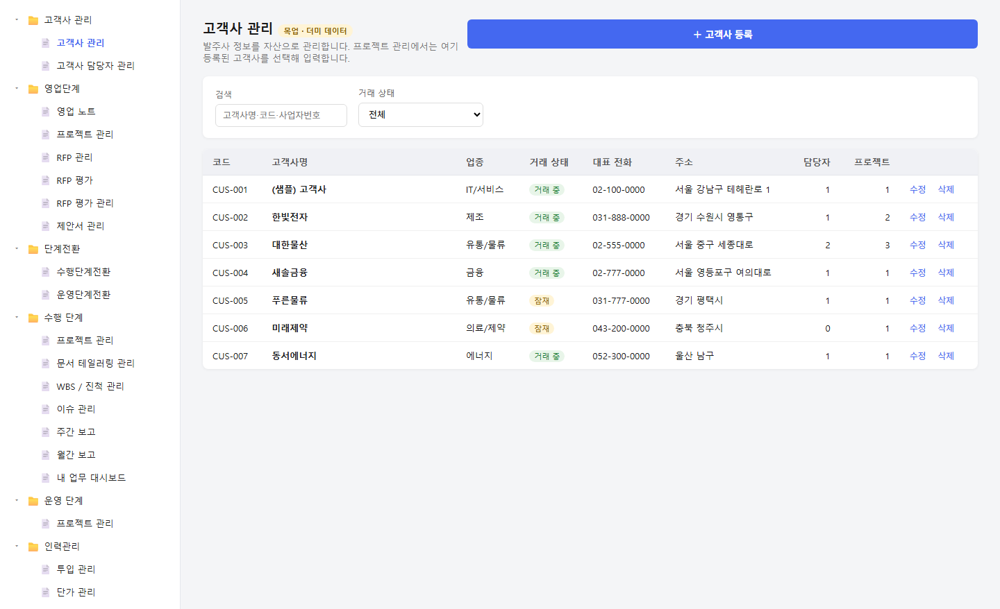

**기능 설명**
1. 발주사(고객사) 마스터를 목록으로 조회합니다. 고객사명·코드·사업자번호 검색과 거래 상태(거래 중/잠재/거래 종료) 필터를 제공합니다.
2. 「고객사 등록」·「수정」으로 고객사명(필수), 업종, 거래 상태, 사업자등록번호, 대표 전화, 주소, 홈페이지, 비고를 관리합니다.
3. 목록에 고객사별 담당자 수와 프로젝트 수를 표시합니다.
4. 프로젝트에서 사용 중인 고객사는 삭제할 수 없으며(거래 종료로 변경), 삭제 시 해당 고객사의 담당자도 함께 삭제됩니다.
5. 프로젝트 관리의 발주사는 여기 등록된 고객사에서 선택합니다.

---

## 고객사 관리 > 고객사 담당자 관리

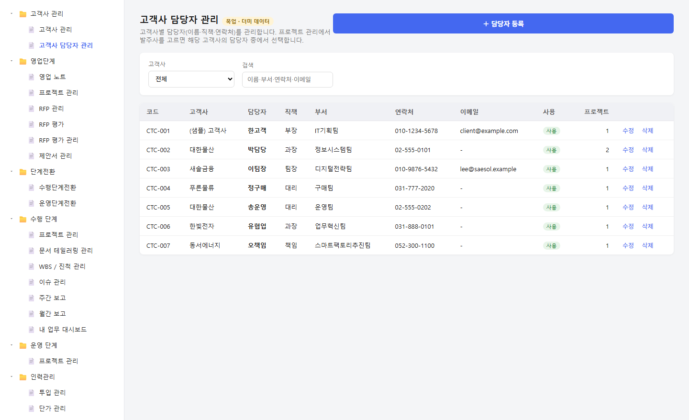

**기능 설명**
1. 고객사별 담당자를 목록으로 조회합니다. 고객사 필터와 이름·부서·연락처·이메일 검색을 제공합니다.
2. 「담당자 등록」·「수정」으로 고객사(필수), 담당자명(필수), 직책, 부서, 연락처, 이메일, 사용 여부, 비고를 관리합니다. 연락처와 이메일 중 하나는 반드시 입력합니다.
3. 퇴사·이동한 담당자는 「미사용」으로 바꿔 프로젝트 선택 목록에서 제외합니다.
4. 목록에 담당자별 연결된 프로젝트 수를 표시하며, 사용 중인 담당자는 삭제할 수 없습니다.
5. 프로젝트 관리에서 발주사를 고르면 해당 고객사의 담당자 중에서 선택합니다.

---

## 영업단계 > 영업 노트

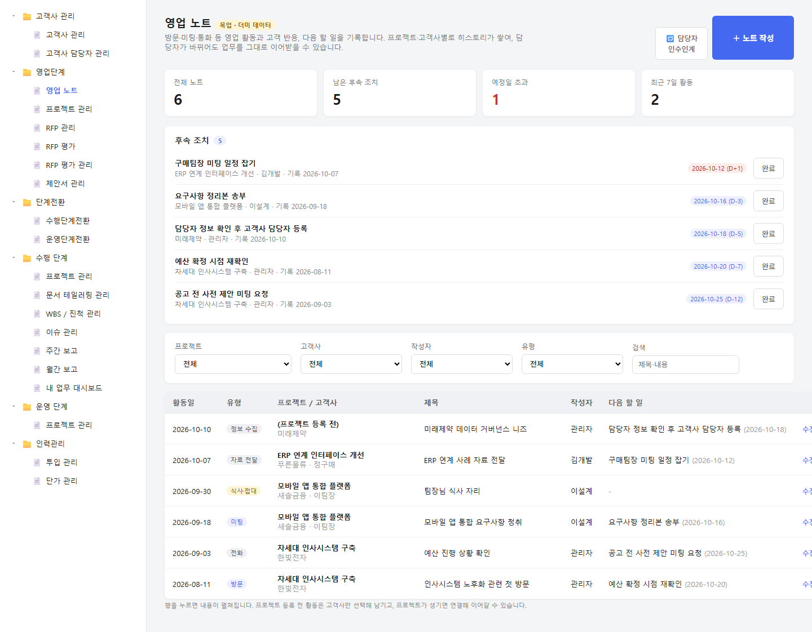

**기능 설명**
1. 방문·미팅·전화·이메일·식사·접대·제안·발표·자료 전달·정보 수집 등 영업 활동을 기록합니다. 활동일, 프로젝트 또는 고객사(둘 중 하나 필수), 만난 담당자, 제목, 내용, 다음 할 일과 예정일을 입력합니다.
2. 상단 요약(전체 노트, 남은 후속 조치, 예정일 초과, 최근 7일 활동)과 예정일순 「후속 조치」 목록을 제공하며, 「완료」로 처리합니다.
3. 프로젝트·고객사·작성자·유형·키워드로 검색하고, 행을 누르면 내용이 펼쳐지는 최신순 타임라인으로 봅니다.
4. 「담당자 인수인계」: 영업 진행 중 프로젝트와 인수 담당자를 고르면 활동 히스토리·남은 후속 조치·메모를 모은 요약을 자동 생성(복사 가능)하고, 처리하면 영업 담당자가 변경되며 「인수인계」 노트가 기록됩니다.
5. 프로젝트 등록 전 활동도 고객사만 선택해 남길 수 있습니다.

---

## 영업단계 > 프로젝트 관리

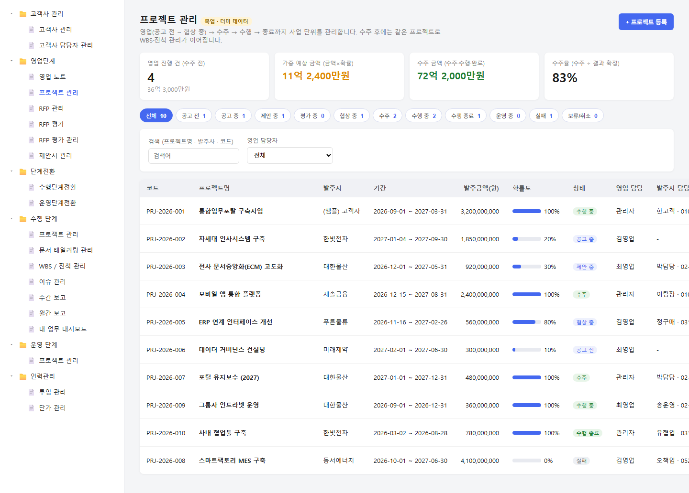

**기능 설명**
1. 영업(공고 전~협상 중) → 수주 → 수행 → 종료까지 하나의 프로젝트 레코드로 관리합니다. 상태별 건수 칩, 검색(프로젝트명·발주사·코드), 영업 담당자 필터를 제공합니다.
2. 상단 집계: 영업 진행 건수·금액, 가중 예상 금액(금액 × 확률), 수주 금액, 수주율.
3. 등록·수정 폼에서 필수/조건부 필수/옵션 항목을 구분해 입력합니다. 상태를 바꾸면 수주 확률도 기본값이 자동 제안되고, 제안 단계부터 발주사 담당자 정보가, 실패·보류 시 사유가 필수입니다. 예상 원가를 입력하면 예상 이익률이 계산됩니다.
4. 발주사는 고객사 관리, 발주사 담당자는 고객사 담당자 관리에서 선택합니다(직책·연락처·이메일은 읽기 전용). 영업 담당자는 사용자 목록에서 선택합니다.
5. 목록 맨 뒤 「영업노트 보기」로 해당 프로젝트의 영업 노트를 한눈에 확인합니다.

---

## 영업단계 > RFP 관리

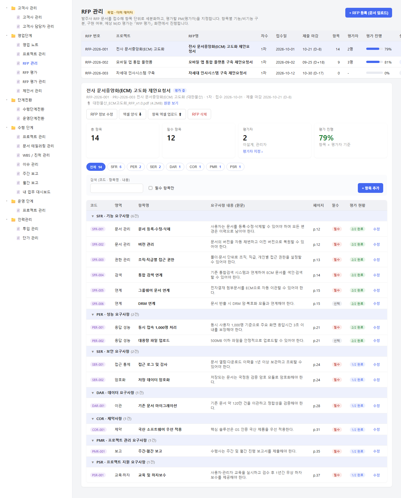

**기능 설명**
1. 프로젝트에 연결되는 RFP(차수·접수일·제출 마감일)를 등록하고 원본 문서(pdf/hwp/docx/xlsx)를 업로드합니다.
2. RFP 항목을 엑셀 템플릿 업로드 또는 수동 입력으로 정리합니다. 항목은 발주사 원문 분류(SFR·PER·SER 등), 영역, 항목코드, 항목명, 요구사항 원문, 원문 페이지, 필수/선택으로 구성됩니다.
3. 항목은 분류별로 열거되며 코드·항목명·내용으로 검색합니다.
4. 평가자(수행 조직 PM)를 1명 이상 지정합니다.
5. RFP 상태(접수 → 항목 정리 중 → 평가 중 → 평가 완료)와 평가 진행률(항목 × 평가자 기준)을 표시합니다.

---

## 영업단계 > RFP 평가

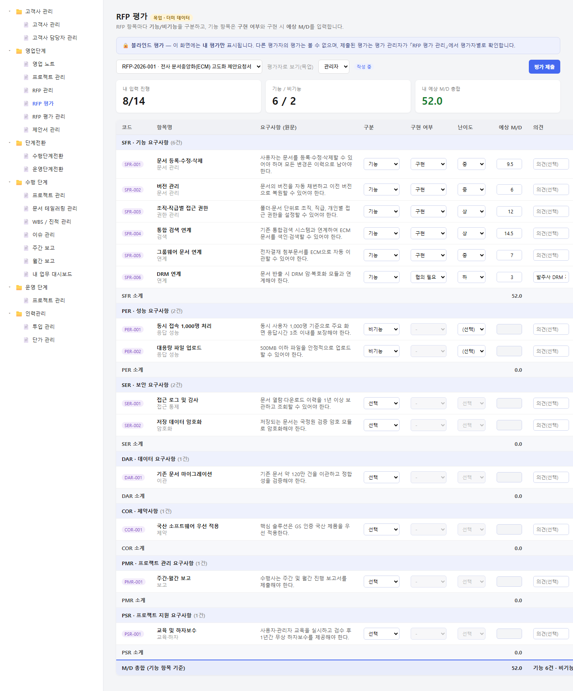

**기능 설명**
1. 평가자 본인의 평가만 보이는 블라인드 화면입니다(다른 평가자의 평가는 볼 수 없음).
2. 항목마다 기능/비기능 구분, 구현 여부(구현/일부 구현/미구현/협의 필요), 구현 시 예상 M/D, 난이도(하/중/상), 의견을 입력합니다. 구현·일부 구현이면 M/D가 필수이고 미구현은 0, 비기능은 M/D가 없습니다.
3. 상단에 내 입력 진행과 분류별 M/D 소계, 내 예상 M/D 총합(기능 항목 기준)을 표시합니다.
4. 모든 항목을 입력해야 「평가 제출」이 가능하며, 제출 후에는 수정할 수 없습니다(평가 관리자의 재평가 요청으로 해제).
5. 「평가자로 보기(목업)」로 평가자를 바꿔 확인할 수 있습니다.

---

## 영업단계 > RFP 평가 관리

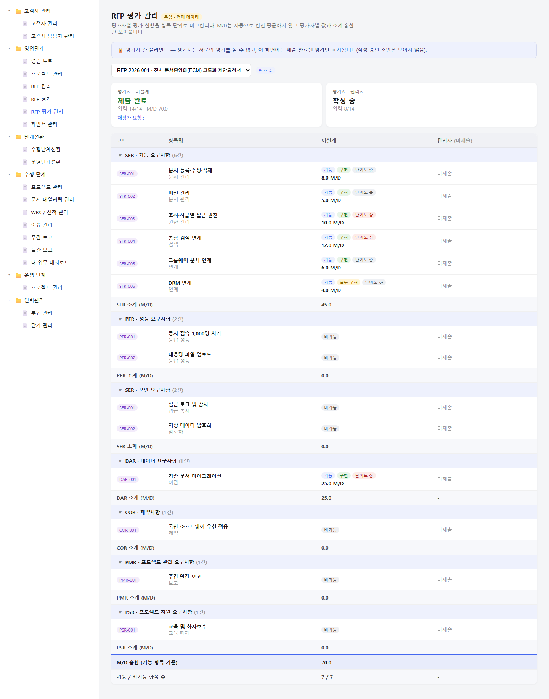

**기능 설명**
1. 항목을 열거하고 평가자별 열로 구분·구현 여부·M/D를 나란히 보여줍니다. 제출 완료된 평가만 표시하며 작성 중 초안은 비공개입니다.
2. 평가자별 제출 현황과 입력 진행을 표시합니다.
3. 평가자마다 구분이 다른 항목은 「구분 상이」로 표시합니다.
4. 분류(SFR·PER·SER 등)별 M/D 소계와 표 최하단 M/D 총합을 평가자별로 표시합니다(기능 항목 기준). 총합 아래에 기능/비기능 항목 수를 표시합니다.
5. M/D는 평균·최댓값 같은 자동 취합 없이 평가자별 값만 보여줍니다. 난이도는 참고 정보로 평가자별 표시합니다.

---

## 영업단계 > 제안서 관리

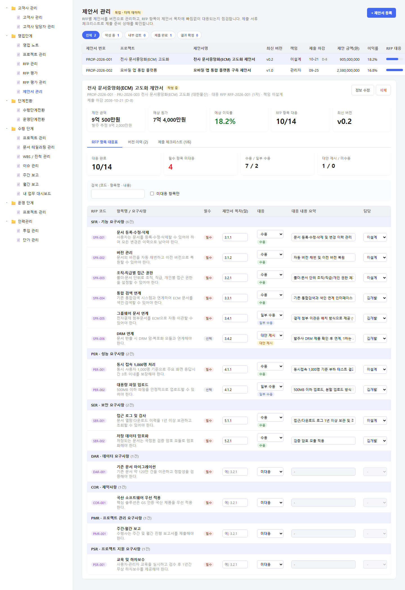

**기능 설명**
1. 프로젝트·대응 RFP를 연결해 제안서를 등록합니다. 작성 책임자, 상태(작성 중 → 내부 검토 → 제출 완료 → 결과 확정), 제출 마감일(D-day), 제출일, 제안 금액, 예상 원가와 예상 이익률을 관리합니다.
2. 버전 이력: 버전별 파일·작성자·변경 요약을 보관하고 제출본을 표시합니다. 새 버전 업로드를 지원합니다.
3. RFP 항목 대응표: 항목마다 제안서 목차(절), 대응 방식(수용/일부 수용/대안 제시/미수용), 대응 요약, 담당자를 입력합니다. 대응 완료 수와 필수 항목 미대응 건수를 상단에 표시합니다.
4. 제출 체크리스트로 제출 서류(본문·요약본·가격 제안서·인증서·위임장 등) 준비 현황을 관리합니다.
5. 제출 완료 후에는 대응표를 수정할 수 없습니다.

---

## 단계전환 > 수행단계전환

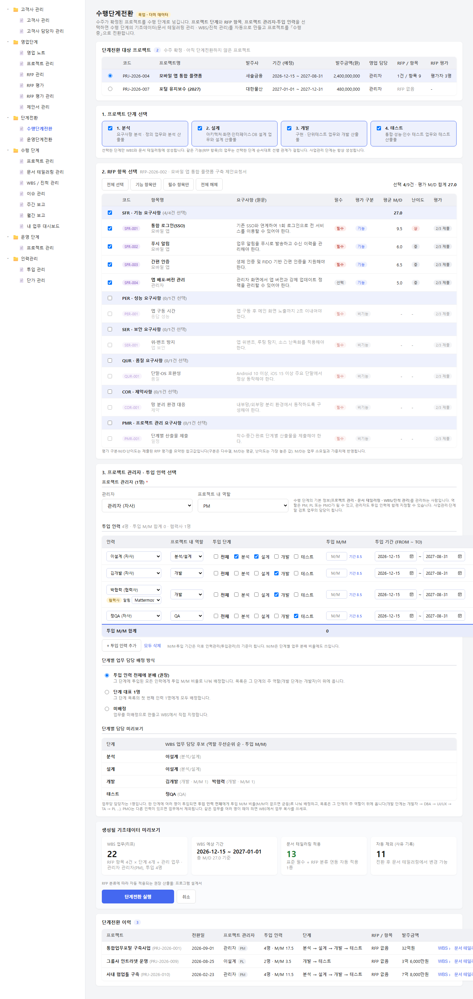

**기능 설명**
1. 상태가 「수주」이고 아직 전환하지 않은 프로젝트를 목록에서 선택합니다(RFP·항목 수, 평가자 수 표시). 화면은 대상 프로젝트를 선택한 상태입니다.
2. 수행할 단계(분석/설계/개발/테스트)를 선택하고, RFP 항목을 분류별로 선택합니다(전체/기능만/필수만/해제). 제출된 RFP 평가의 구분·평균 M/D·난이도를 참고값으로 보여줍니다.
3. 프로젝트 관리자(PM/PL/PMO 중 1명)와 투입 인력(역할·투입 단계·M/M·기간)을 지정하고, 단계별 업무 담당 배정 방식(투입 인력 전체 분배 / 단계 대표 1명 / 미배정)과 담당 후보 미리보기를 확인합니다.
4. 생성될 WBS 업무 수·예상 기간·문서 테일러링 적용/제외 수를 미리보고 「단계전환」을 실행하면 프로젝트가 「수행 중」이 되고 WBS·문서 테일러링 기초데이터가 생성됩니다.
5. 하단에 단계전환 이력과 WBS·문서 테일러링 바로가기를 제공합니다.

---

## 단계전환 > 운영단계전환

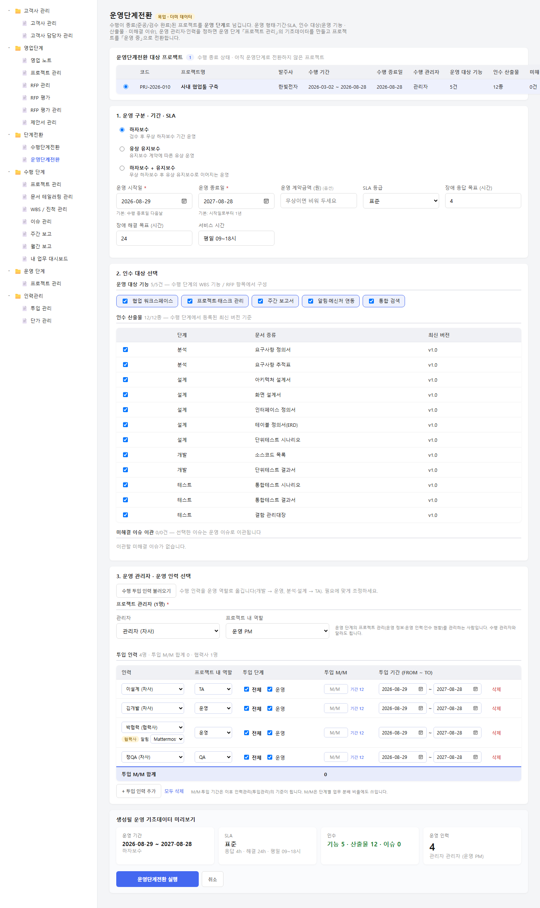

**기능 설명**
1. 「수행 종료」 상태이면서 아직 운영 전환하지 않은 프로젝트를 선택합니다. 화면은 대상 프로젝트를 선택한 상태입니다.
2. ① 운영 형태(하자보수/유상 유지보수/하자보수+유지보수)·운영 기간(기본: 수행 종료 다음날부터 1년)·계약금액·SLA(등급, 장애 응답·해결 목표 시간, 서비스 시간)를 입력합니다.
3. ② 인수 대상 선택: 운영 대상 기능, 인수 산출물(수행에서 등록된 최신 버전), 이관할 미해결 이슈를 고릅니다.
4. ③ 운영 관리자(1명)와 운영 인력(역할·M/M·투입 기간)을 지정하며, 수행 인력 불러오기를 지원합니다.
5. 미리보기 후 「운영단계전환 실행」을 누르면 프로젝트가 「운영 중」이 되고 운영 기초데이터가 생성됩니다. 하단에 운영 전환 이력을 표시합니다.

---

## 수행 단계 > 프로젝트 관리

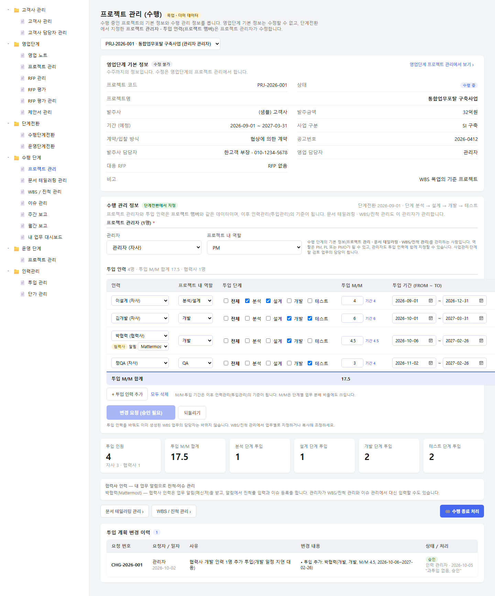

**기능 설명**
1. 영업단계에서 입력한 기본 정보(코드·상태·프로젝트명·발주사·발주금액·기간·사업 구분·입찰 방식·발주사 담당자·영업 담당자·대응 RFP 등)를 읽기 전용으로 표시합니다.
2. 수행 관리 정보: 단계전환에서 지정한 프로젝트 관리자와 투입 인력(역할·투입 단계·M/M·기간·협력사 알림 채널)을 수정합니다. 수정은 프로젝트 관리자 본인만 가능합니다.
3. 변경 시 바로 반영하지 않고 변경 사유를 포함한 「투입 계획 변경 요청」으로 등록되며, 인력 관리자 승인 후 반영됩니다(변경 내용과 승인 시 과투입 예상 표시).
4. 투입 인원, 자사/협력사 구성, M/M 합계 요약과 문서 테일러링·WBS 바로가기를 제공합니다.
5. 수행 종료 처리: 수행 종료일, 비고, 운영 인수 대상 기능을 확정합니다(미완료 업무·미해결 이슈 경고).

---

## 수행 단계 > 문서 테일러링 관리

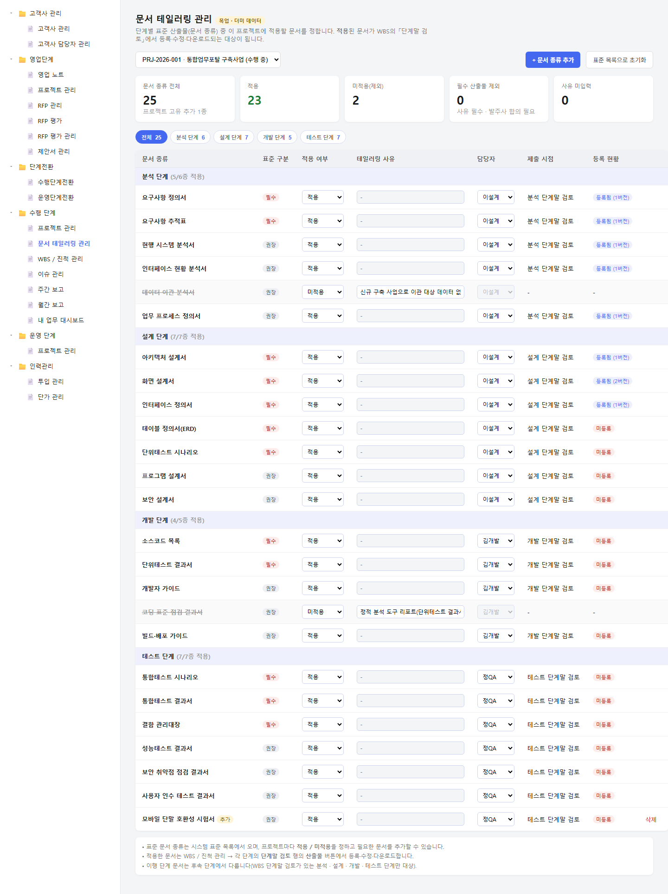

**기능 설명**
1. 단계(분석·설계·개발·테스트)별 표준 산출물 목록에서 프로젝트에 적용할 문서를 정합니다(적용/미적용).
2. 미적용은 사유가 필수이며, 표준 필수 산출물을 제외하면 발주사 합의 필요 경고와 제외 사유를 요구합니다. 필수 제외 건수와 사유 미입력 건수를 상단에 집계합니다.
3. 문서별 담당자를 지정하고, 프로젝트 고유 문서 종류를 추가·삭제하며, 표준 목록으로 초기화할 수 있습니다.
4. 제출 시점은 「해당 단계 단계말 검토」로 고정됩니다.
5. 등록 현황(미등록/등록)을 함께 표시합니다.

---

## 수행 단계 > WBS / 진척 관리

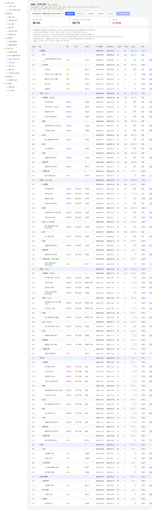

**기능 설명**
1. WBS가 있는 프로젝트를 선택해 단계 → 분류 → 작업 트리로 봅니다. 「기능 × 단계」 매트릭스 보기도 제공합니다.
2. 리프(최하위) 작업만 실적(%)을 입력하며 상위 행은 하위 가중평균으로 자동 계산됩니다. 전체 실적 공정율과 계획 대비를 표시합니다.
3. 기능 업무는 분석 → 설계 → 개발 → 테스트 순으로 선행 업무가 완료돼야 후행 업무 진척을 입력할 수 있습니다(선행 대기 표시).
4. 업무 복사: 담당자를 바꿔 업무를 복제하며 가중치는 균등 분배됩니다.
5. 업무 행의 「⚠ 이슈 미해결/전체」 버튼으로 그 업무의 이슈를 조회·등록·연결·해제하고, 상위 행에는 하위 이슈 합계 배지를 표시합니다.
6. 단계말 검토 행의 「📄 산출물 n/m」 버튼으로 적용 문서를 등록·새 버전·수정·다운로드·삭제·검토 완료 처리합니다.

---

## 수행 단계 > 이슈 관리

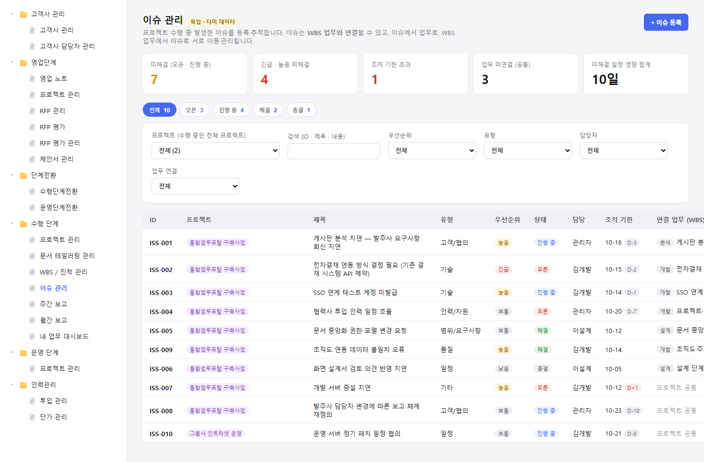

**기능 설명**
1. 프로젝트 조회 조건: 일반 사용자는 내가 참여 중인 수행 프로젝트, 센터장·admin은 수행 중인 전체 프로젝트의 이슈를 봅니다. 목록에 프로젝트명을 표시합니다.
2. 상단 집계(미해결, 긴급·높음 미해결, 조치 기한 초과, 업무 미연결, 미해결 일정 영향 합계)와 상태 칩, 검색·우선순위·유형·담당자·업무 연결 여부 필터를 제공합니다.
3. 이슈 등록·수정: 제목, 유형, 우선순위, 상태(오픈 → 진행 중 → 해결 → 종결), 담당자, 조치 기한, 일정 영향(일), 연결 업무, 내용, 조치 내용(해결·종결 시 필수)을 입력하며 처리 이력이 자동 기록됩니다.
4. 연결 업무 옆 「WBS ›」로 WBS의 해당 업무로 이동합니다.

---

## 수행 단계 > 주간 보고

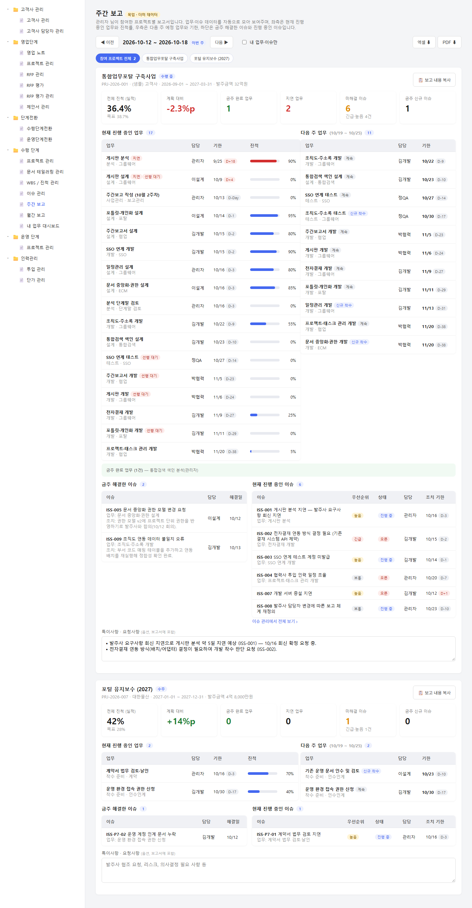

**기능 설명**
1. 참여 프로젝트별 보고 블록을 나열하고 프로젝트 칩으로 필터링합니다.
2. 좌측 「현재 진행 중인 업무」(지연·선행 대기 표시, 담당·기한·진척률)와 우측 「다음 주 업무」(신규 착수/계속)를 보여줍니다.
3. 하단에 금주 해결한 이슈와 현재 진행 중인 이슈(우선순위·상태·담당·조치 기한)를 표시합니다.
4. 프로젝트 요약 KPI(전체 진척, 계획 대비, 금주 완료, 지연 업무, 미해결 이슈, 금주 신규 이슈)를 제공합니다.
5. 기간 이동, 이번 주로 복귀, 내 업무·이슈만 보기 토글, 특이사항·요청사항 입력, 보고 내용 복사, 엑셀/PDF 내보내기(목업)를 지원합니다.

---

## 수행 단계 > 월간 보고

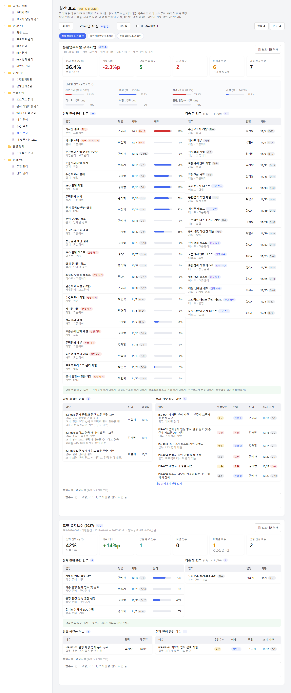

**기능 설명**
1. 주간 보고와 같은 구성을 월 단위로 제공합니다(당월 진행 업무 / 다음 달 업무 / 당월 해결 이슈 / 진행 중 이슈).
2. 월간 보고에는 단계별 진척(실적/목표) 막대를 추가로 표시합니다.
3. 프로젝트별 KPI, 기간 이동, 내 업무·이슈만 보기, 특이사항 입력, 보고 내용 복사, 내보내기(목업)를 지원합니다.
4. 진척률은 조회 시점 기준입니다(기간별 이력은 진척 스냅샷 도입 후).

---

## 수행 단계 > 내 업무 대시보드

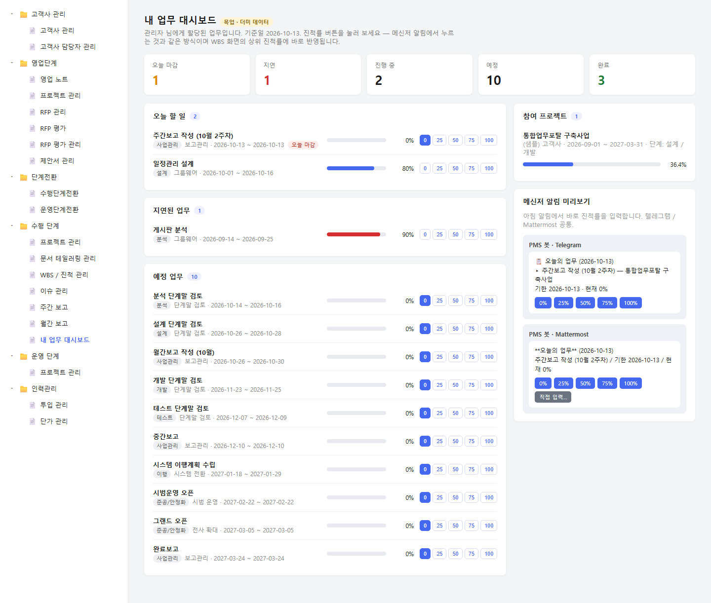

**기능 설명**
1. 로그인 사용자에게 배정된 업무를 「오늘 할 일 / 지연된 업무 / 예정 업무」로 나눠 보여줍니다.
2. 업무별 진척률을 빠른 버튼 또는 직접 입력으로 갱신합니다. 선행 업무가 끝나지 않은 업무는 입력할 수 없습니다.
3. 복사된 업무(복수 담당)를 표시합니다.
4. 「메신저 알림 미리보기」에서 Mattermost/Telegram 봇이 보내는 오늘 할 일 알림과 버튼으로 진척을 입력하는 모습을 확인합니다(목업).

---

## 운영 단계 > 프로젝트 관리

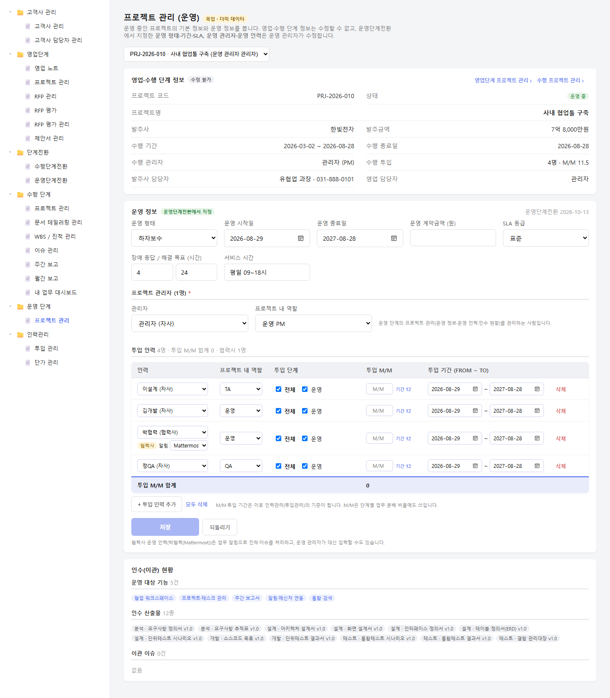

**기능 설명**
1. 운영 중인 프로젝트를 선택해 영업·수행 단계 정보를 읽기 전용으로 확인합니다.
2. 운영 정보(운영 형태·기간·계약금액, SLA 등급·장애 응답/해결 목표 시간·서비스 시간)를 수정합니다. 수정은 운영 관리자만 가능합니다.
3. 운영 관리자(1명)와 운영 인력(역할·투입 단계·M/M·투입 기간·협력사 알림 채널)을 관리합니다.
4. 인수(이관) 현황으로 운영 대상 기능, 인수 산출물(버전 포함), 이관 이슈를 표시합니다.
5. 이 화면은 운영단계전환을 실행한 뒤의 상태입니다.

---

## 인력관리 > 투입 관리

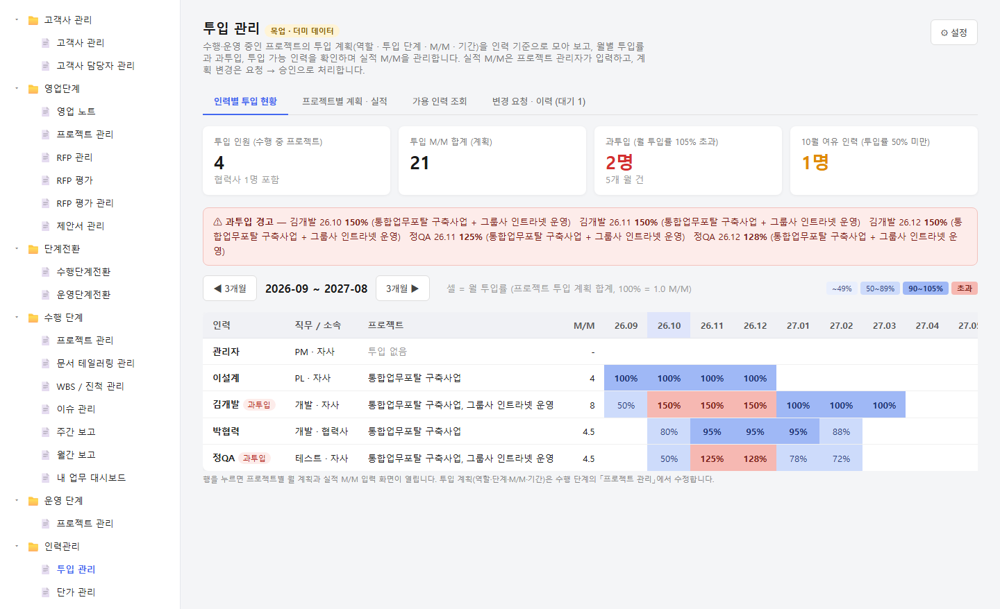

**기능 설명**
1. 「인력별 투입 현황」: 인력 × 월 투입률 히트맵(3개월 단위 이동), 투입 프로젝트·M/M, 과투입 태그와 경고 목록, 요약(투입 인원, M/M 합계, 과투입 인원, 당월 여유 인력)을 보여줍니다. 인력을 누르면 월별 계획 M/M과 실적 M/M을 확인합니다.
2. 「프로젝트별 계획·실적」: 프로젝트 투입 인력별 계획 M/M, 실적 M/M, 소진율, 타 프로젝트와 겹쳐 과투입인 달을 표시합니다. 실적 M/M은 프로젝트 관리자만 입력합니다.
3. 「가용 인력 조회」: 기간·필요 투입률·직무로 투입 가능/여유 부족을 판정합니다.
4. 「변경 요청·이력」: 투입 계획 변경 요청을 승인·반려하고 이력을 확인합니다(승인 시 과투입 예상 표시).
5. 「설정」에서 과투입 기준(기본 105%)과 여유 인력 기준(기본 50%)을 변경하면 즉시 반영됩니다.

---

## 인력관리 > 단가 관리

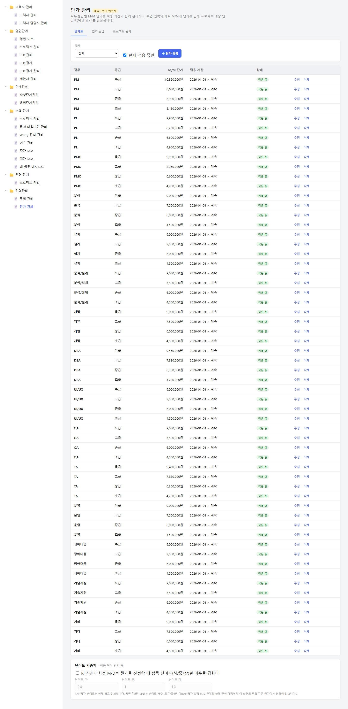

**기능 설명**
1. 「단가표」: 직무 × 등급(특급/고급/중급/초급)별 M/M 단가를 적용 기간과 함께 등록·수정·삭제합니다. 같은 직무·등급의 적용 기간이 겹치면 저장할 수 없습니다. 직무 필터와 「현재 적용 중만」 보기를 제공합니다.
2. 「인력 등급」: 인력별 등급을 지정하고, 등급 미지정·단가 없음 인력을 표시합니다.
3. 「프로젝트 원가」: 프로젝트별 투입 인력의 월별 계획 M/M × 그 달 적용 단가를 합산해 예상 인건비, 직무별 소계, 발주금액 대비 인건비 기준 이익률, 단가 누락 경고를 보여줍니다.
4. 하단 「난이도 가중치」 설정(하/중/상 배수)은 적용 여부가 협의 중이며 현재 투입 기준 원가에는 영향이 없습니다.
